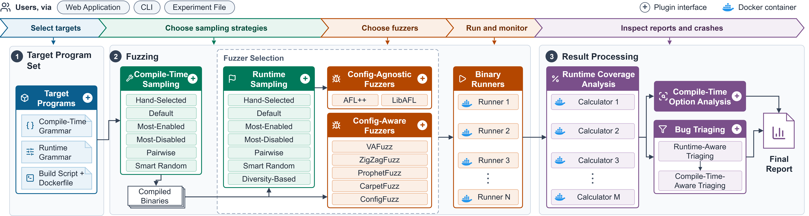

# ConfigFuzzEval



ConfigFuzzEval is a fuzzing infrastructure for two use cases: (1) evaluating configuration-aware and configuration-agnostic fuzzers, and (2) orchestrating fuzzing campaigns across sampled compile-time and runtime configurations. It provides statistical coverage analyses, crash triaging, and integration with SuperC for compile-time analysis. It is extensible through plugin interfaces for fuzzers, sampling strategies, triaging tools, compile-time analysis tools and target programs. Experiments run from a web application ([docs/web-app.md](docs/web-app.md), [live demo](docs/live-demo.md) at https://configfuzzeval.vercel.app/), or from CI/CD pipelines through the CLI or experiment files.

## Quick start

On a Linux machine with Docker and LLVM 18, from the root of the project:

```bash
python3 -m pip install -r requirements.txt   # the Python packages
# create config.yaml, as shown in docs/README.md#installation
sudo ./run_as_sudo.sh                        # core_pattern and CPU governor, for stable numbers
python3 common/run_experiment.py             # asks what to run, then queues it
```

The full steps are in [Installation](docs/README.md#installation). To try the web app without installing anything,
open the [live demo](docs/live-demo.md).

## Concepts

### Experiments, runs, trials and arms

- An **experiment** is everything started at once, under one name. Its results go to
  `<experiment_filestore>/<name>` and its reports to `<report_filestore>/<name>`.
- A **run** is one fuzzer on one benchmark with one compile-time and one runtime strategy.
- A **trial** is one independent fuzzing session of a run, in its own Docker container on its own core, for
  `max_total_time` seconds. Each run has `trials` trials, so the reports can test whether differences are
  significant.
- An **arm** is what the reports compare: a fuzzer under one strategy, written `fuzzer[runtime strategy]`, with
  `{cts:compile-time strategy}` added for a non-default compile-time strategy. For example `aflplusplus[pairwise]`
  or `vafuzz{cts:maximum}`.

The experiments run one at a time in the [job queue](docs/README.md#job-queue). At the end, each experiment writes
the [statistics report](docs/statistics-report.md) and the [coverage reports](docs/coverage-reports.md), and the
[SuperC analysis](docs/superc.md) and [crash triage](docs/crash-triage.md) when they are asked for.

### Fuzzers

Every folder in `fuzzers/` is a fuzzer, of one of two kinds:

- A **config-agnostic** fuzzer (aflplusplus, libafl) fuzzes the input file under the command line it is given. The
  [runtime strategies](#runtime-strategies) give it the configurations to fuzz.
- A **config-aware** fuzzer (vafuzz, configfuzz, carpetfuzz, prophetfuzz, zigzagfuzz) chooses the program's options
  itself, from files of the benchmark such as `rt_grammar.json` or `dict`. It always runs with the default runtime
  strategy.

Both kinds run under every [compile-time strategy](#compile-time-strategies). Every way of running an experiment
asks for the same four things: fuzzers, benchmarks, compile-time strategies and runtime strategies.

### Compile-time strategies

Many programs can be built in many ways: `./configure` options turn features on or off, and with them the code that
is compiled in (`#if` blocks). A **compile-time strategy** samples these build configurations from the benchmark's
`ct_grammar.json`, which lists its options and the constraints between them. Each configuration is built as its own
copy of the benchmark, and a trial's fuzzing time is split over the copies, so every strategy gets the same total
time. Compile-time strategies apply to every fuzzer.

| Strategy | Configurations, built from the benchmark's `ct_grammar.json` |
|---|---|
| `default` | 1: the benchmark's own build, with no extra options |
| `manual` | the hand-written configuration of each benchmark (in `compiletime/manual/strategy.py`) |
| `maximum` | 1 configuration with as many options on as the grammar's constraints allow |
| `minimum` | 1 configuration with every option off, and every choice at its default |
| `pairwise` | a 2-way covering array: every valid pair of option values appears together at least once |
| `randomsmart` | 10 random configurations that satisfy the grammar's constraints |

How the copies are made and named, the grammar format, and adding a strategy:
[Compile-time strategies in depth](docs/README.md#compile-time-strategies-in-depth).

### Runtime strategies

Programs also take command-line options that change what code their input reaches. A **runtime strategy** samples
these run-time configurations from the benchmark's `rt_grammar.json`, instead of the single command in its
`run_target.sh`. A trial fuzzes the configurations one after another, each for an equal share of its time and each
starting from the previous one's corpus, on the benchmark's normal build, so it only adds trials, not builds.
Runtime strategies apply to the config-agnostic [fuzzers](#fuzzers), listed in `runtime/supported_fuzzers.json`; asking
for one with any other fuzzer stops the experiment with an error before anything is built.

| Strategy | Configurations, built from the benchmark's `rt_grammar.json` |
|---|---|
| `default` | none: the normal run with `run_target.sh` |
| `pairwise` | a 2-way covering array: every pair of option values appears together at least once |
| `random` | 50 random valid configurations |
| `diversity` | 50 valid configurations chosen to be as different as possible (Hamming distance) |
| `mostenabled` | 1 configuration with as many options on as the grammar's constraints allow |
| `mostdisabled` | 1 configuration with every option off |

How the configurations are generated, fuzzed and replayed, the grammar format, and adding a strategy:
[Runtime strategies in depth](docs/README.md#runtime-strategies-in-depth).

## Documentation

| | |
|---|---|
| **Using ConfigFuzzEval** | [User guide](docs/README.md): installation, running an experiment, the job queue, continuous mode, strategies in depth, tests |
| **Running an experiment** | [Command line](docs/run-command-line.md) · [Interactive setup](docs/run-interactive.md) · [Experiment file](docs/run-experiment-file.md) |
| **Web app** | [The web app](docs/web-app.md): starting it, and every page and tab · [Live demo](docs/live-demo.md): https://configfuzzeval.vercel.app/ |
| **Contributing** | [Contributing](docs/CONTRIBUTING.md): adding a benchmark or a fuzzer |
| **Results and analyses** | [Statistics report](docs/statistics-report.md) · [Coverage reports](docs/coverage-reports.md) · [SuperC](docs/superc.md) · [Crash triage](docs/crash-triage.md) |

## Contributing

To add your own fuzzer or benchmark to ConfigFuzzEval, see [docs/CONTRIBUTING.md](docs/CONTRIBUTING.md). It describes
a benchmark's folder and files, with a sample Dockerfile and which files each fuzzer needs, and a fuzzer's folder,
with sample files and how to register it as config-agnostic (to use the runtime strategies) or config-aware.
