# The web app

`webapp/` is a browser front end for the whole FuzzBench++ workflow, from configuring an experiment to reading its
results. It starts the same commands as the command line (`run_experiment.py` with an experiment file, and
`post_analysis.py`) and reads the files they write, so the web app and the terminal can be used side by side.

**Try it without installing anything:** the demo at **https://configfuzzeval.vercel.app/** is a copy of this web
app with no server behind it. Every page works, but nothing runs: queueing shows a notice instead. It has two
finished experiments with mock data, and a short real experiment replayed as if it were running now:

- [`/experiments/1`](https://configfuzzeval.vercel.app/experiments/1): AFL++ under every runtime strategy, plus VAFuzz, on six benchmarks (mock data).
- [`/experiments/2`](https://configfuzzeval.vercel.app/experiments/2): AFL++ and VAFuzz under every compile-time strategy (mock data).
- [`/experiments/live_demo`](https://configfuzzeval.vercel.app/experiments/live_demo): a real 14-trial run with SuperC, crash triage and statistics, replayed about 5× faster than it ran.

Every tab has its own address, for example
[`/experiments/2/superc`](https://configfuzzeval.vercel.app/experiments/2/superc) or
[`/experiments/1/results`](https://configfuzzeval.vercel.app/experiments/1/results). The screenshots below are
from the demo. The demo has a few extras of its own that this web app does not: a **Live** tab with a trial
detail window, a `configure.yaml` editor, and the replay.

Contents: [Starting it](#starting-it) · [Experiments page](#experiments-page) ·
[New experiment](#new-experiment) · [An experiment's page](#an-experiments-page) ·
[Documentation page](#documentation-page) · [Files](#files)

## Starting it

Start the app on the fuzzing machine, from the root of the project:

```bash
python3 webapp/app.py --config config.yaml                 # http://127.0.0.1:8800/
mkdir -p experiments/logs && setsid nohup python3 webapp/app.py --config config.yaml \
  > experiments/logs/webapp.log 2>&1 < /dev/null &            # or in the background
```

Options:

- `--config`: the configuration file. The default is `config.yaml`.
- `--port`: the port. The default is 8800.
- `--host`: the address to listen on. The default is localhost only.
- `--token`: a secret the app asks for (also read from `FBPP_WEBAPP_TOKEN`).

**Access.** Anyone who can reach the app can run Docker containers, which is root-equivalent, so it listens on
localhost only. From another computer, tunnel the port over SSH and open http://localhost:8800/:

```bash
ssh -L 8800:localhost:8800 <fuzzing-machine>
```

The app only listens on other addresses (`--host 0.0.0.0`) when started with `--token SECRET`. Each browser then
opens it once with `?token=SECRET`, and a cookie keeps it signed in.

**Before the first experiment**, run `run_as_sudo.sh` as root. The Experiments page shows a red check when
`core_pattern` is not `core` or the CPU governor is not `performance`. Experiments still run without these
settings, but AFL++ warns, and the coverage numbers are noisier.

## Experiments page

The home page ([demo](https://configfuzzeval.vercel.app/)) lists everything in the experiment filestore,
including experiments started from the command line.

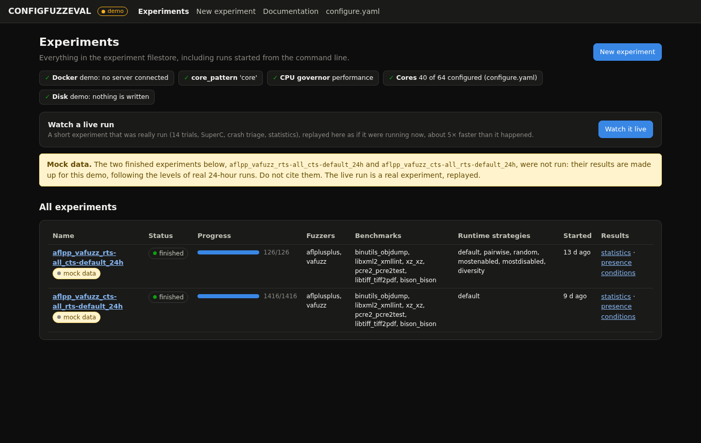

- **Checks:** a row of host checks: Docker, `core_pattern`, the CPU governor and the cores in use. A check turns
  red when something needs attention.
- **Running and queued:** what is running or waiting in the job queue, including experiments started from a
  terminal.
- **All experiments:** every experiment, with its status, its progress (trials done out of planned, failures in
  red), its fuzzers, benchmarks and runtime strategies, when it started, and links to its statistics and presence
  conditions. The status is one of:
  - **queued:** waiting for the machine.
  - **running:** with its current phase.
  - **finished:** the experiment reached its end.
  - **stopped:** it ended early, because it failed or was stopped.
  - **incomplete:** an experiment from before `events.jsonl` existed that has fewer coverage reports than planned
    trials.

## New experiment

**New experiment** ([demo](https://configfuzzeval.vercel.app/new)) is a form that writes an experiment file
(see [Experiment files](../README.md#experiment-files)). The file is on the right, and you can also edit it
directly.

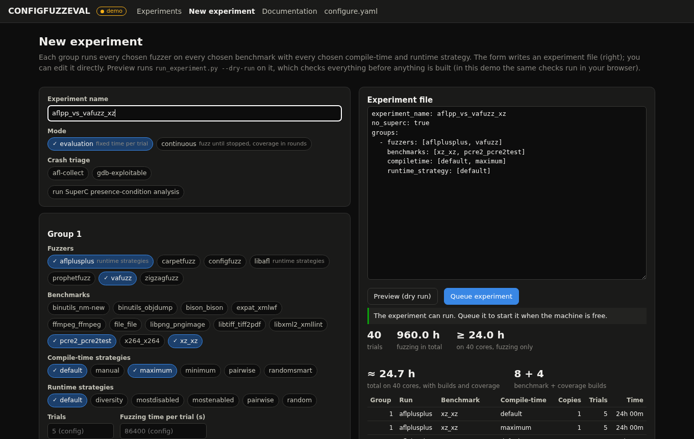

1. **Name the experiment.** It becomes the folder name, so use letters, digits, `.`, `_` and `-`.
2. **Choose the mode:** **evaluation** (a fixed time per trial) or **continuous** (fuzz until stopped, with
   coverage measured in rounds; see [Continuous mode](../README.md#continuous-mode)). Choose any crash triage
   tools, and whether to run the SuperC presence-condition analysis.
3. **Fill in one or more groups.** Each group runs every chosen fuzzer on every chosen benchmark, with every chosen
   compile-time and runtime strategy. **+ Add group** adds another group, with its own choices.
   - **Fuzzer chips:** "runtime strategies" marks the fuzzers that can use a non-default runtime strategy.
   - **Benchmark chips:** a marker says when a benchmark cannot use a choice (for example "no rt grammar"), and
     choices that cannot run are greyed out with the reason.
   - **Trials and fuzzing time:** leave them empty to use `config.yaml`. The line under them gives the fuzzing
     hours and the shortest possible run time on your cores.
   - **Warnings:** a yellow box lists runs that cannot run.
4. **Check the experiment file.** The form writes it as you go. After a hand edit (for example to add a top-level
   `benchmarks` section) the form stops overwriting it; "rewrite from the form" switches it back.
5. **Click Preview (dry run).** This runs `run_experiment.py --dry-run` on the file, which checks every name and
   combination without building anything. A green box means the experiment can run. It is followed by the trials,
   the fuzzing hours, the shortest run time on your cores, the estimated total time with builds and coverage, the
   builds, and one row per run with its benchmark copies. A red box shows the dry run's errors.

   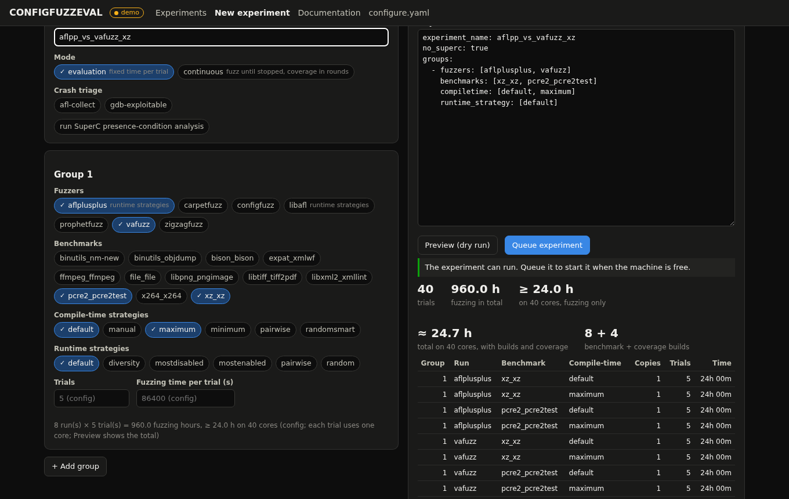
6. **Click Queue experiment.** You can only queue after a preview passes, and after any change you have to preview
   again. The file is saved to `experiments/<name>.yaml`, as for an experiment queued from a terminal, and the log
   goes to `experiments/logs/<name>.log`. The browser then opens the experiment's page.

Jobs (experiments and post-analyses) go into the same queue as experiments queued from a terminal and run **one
at a time** (see [How experiments run](../README.md#how-experiments-run)). Jobs run as their own processes, so they
keep going if the web app is stopped or restarted, and the background worker starts queued jobs while the web app
is down.

## An experiment's page

Each experiment has a page with a header and a row of tabs, for example
[`/experiments/2`](https://configfuzzeval.vercel.app/experiments/2).

### Header

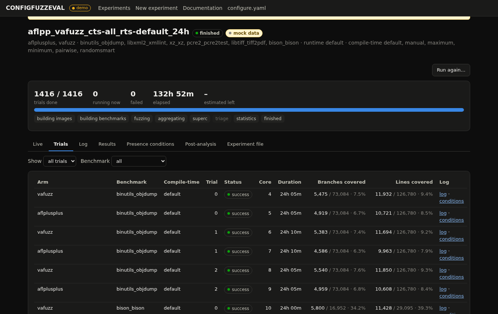

- **Progress:** the trials done, running and failed; the time elapsed; and, while fuzzing, an estimate of the time
  left from the trials finished so far.
- **Phases:** building images, building benchmarks, fuzzing, aggregating, SuperC, triage, statistics, finished.
  The current phase is highlighted, and phases the experiment does not use are greyed out.
- **Stop experiment:** shown while the experiment runs. It kills the experiment's processes and every trial
  container labelled `fbpp.experiment=<name>`. Finished trials are kept, and the experiment then shows as stopped.
- **Run again…:** opens the New experiment form with this experiment's file, under a new name (`<name>_rerun`).
- **Continuous campaigns** get a campaign card instead: the coverage round, the time to the next round, how many
  instances are fuzzing, and when the campaign ends. **Run a coverage round now** replays the new inputs at once;
  **Stop campaign** stops the fuzzers and runs a last round; **Cancel (no last round)** kills it at once.

### Trials

One row per planned trial (screenshot above), which you can filter by status and by benchmark. Each row has the
arm (`fuzzer[runtime strategy]`, with `{cts:…}` for a compile-time strategy), the benchmark, the compile-time
strategy (and the benchmark copy), the trial number, the status, the core, the duration, the branches and lines
covered (covered / instrumented, %, from the trial's `coverage/report.txt`), and links to the trial's **log** and
its presence-condition table (**conditions**). The status is one of:

- **queued:** not started yet.
- **running:** on the core shown.
- **success:** fuzzing and coverage finished.
- **failure:** the trial's log says why.
- **skipped:** its coverage binary did not build.
- **interrupted:** it started but the experiment stopped.

### Log

The experiment's log, updating live with **follow** on. The menu also has the log of each post-analysis job. A long
log opens at its last 60,000 characters.

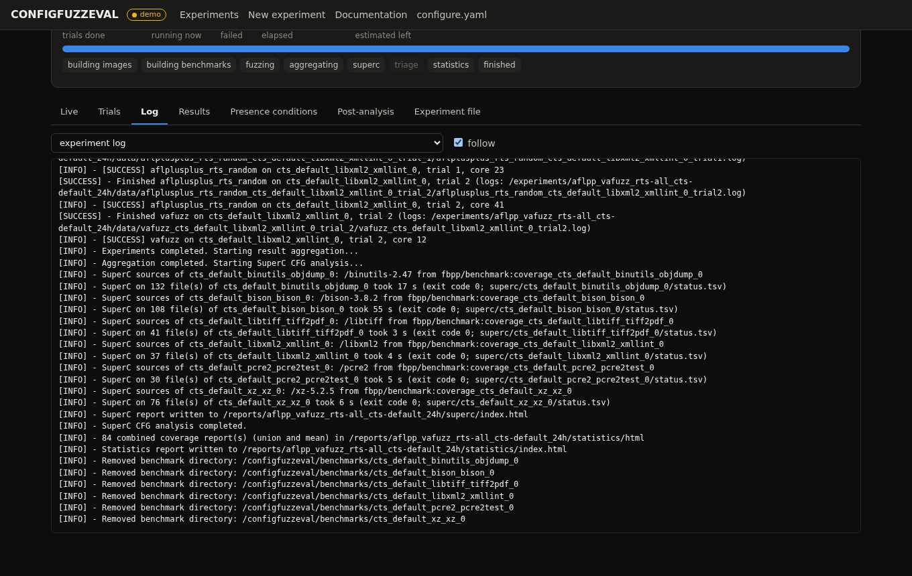

### Results

The statistics report embedded in the page, with **Open the report in a new tab**, its CSV tables, and
**Combined coverage: union & mean**.

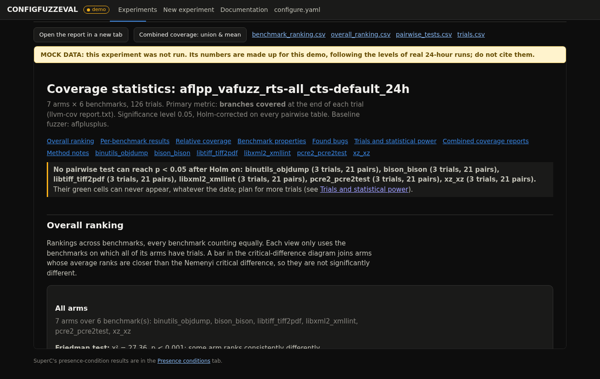

**The statistics report** ranks the arms over all benchmarks (average ranks, normalized scores, first places, a
Friedman test and a Nemenyi critical-difference diagram), and per benchmark gives box plots, pairwise
Mann-Whitney tests (Holm-corrected) with Vargha-Delaney effect sizes, the "against the default" table, unique
coverage, Jaccard similarity and UpSet intersections. It also has relative coverage, benchmark properties, found
bugs, a statistical-power section and method notes. See [Statistics report](../README.md#statistics-report), and read
[Limits of the analyses](../README.md#limits-of-the-analyses) before quoting a p-value.

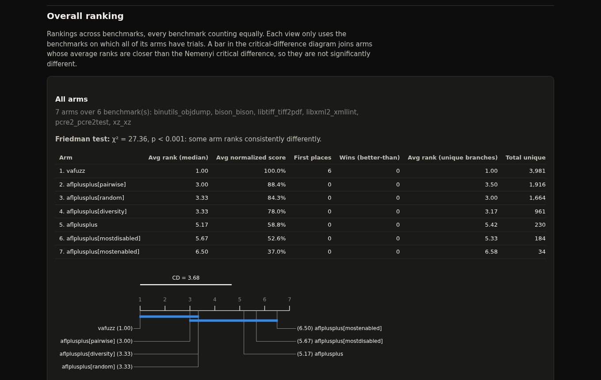

For a first look: start with **Overall ranking**, then each benchmark's **Against the default** table, which has
the most statistical power, then the box plots to see how much the trials vary.

**Combined coverage reports** combine each arm's trials into one source-level report, in two ways, always both:

- **Union:** what any trial covered. This is llvm-cov's own HTML report of the merged profiles, or, for arms whose
  trials ran on several benchmark copies, the union of their LCOV reports.
- **Mean:** what a typical trial covers. It gives the mean ± standard deviation over the trials of the regions,
  functions, lines and branches covered (with the worst and best trial), a table per file, and `mean_files.csv`.

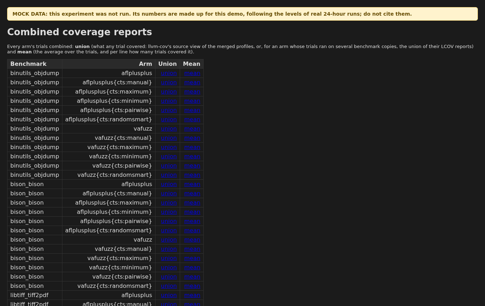

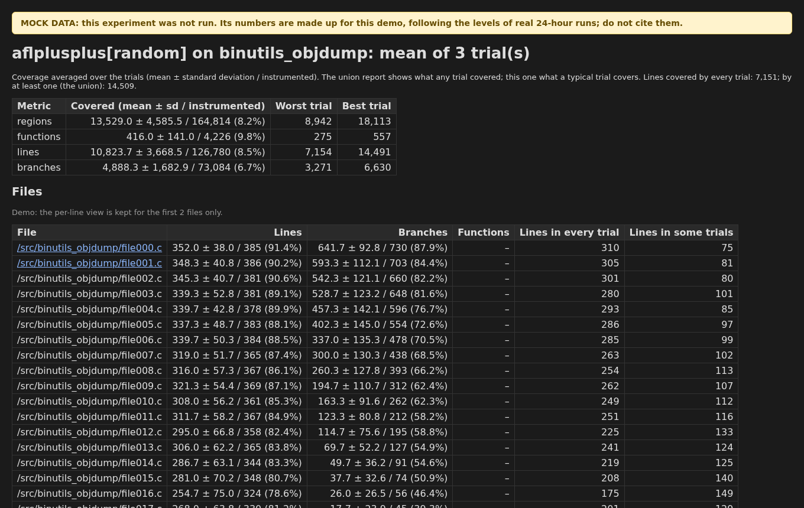

Per source line, both show how many of the trials covered the line (green: all, yellow: some, red: none) and its
mean (or, for the union, total) execution count. In the demo the files are synthetic, so no source text is shown;
a real experiment's report shows the source next to each line.

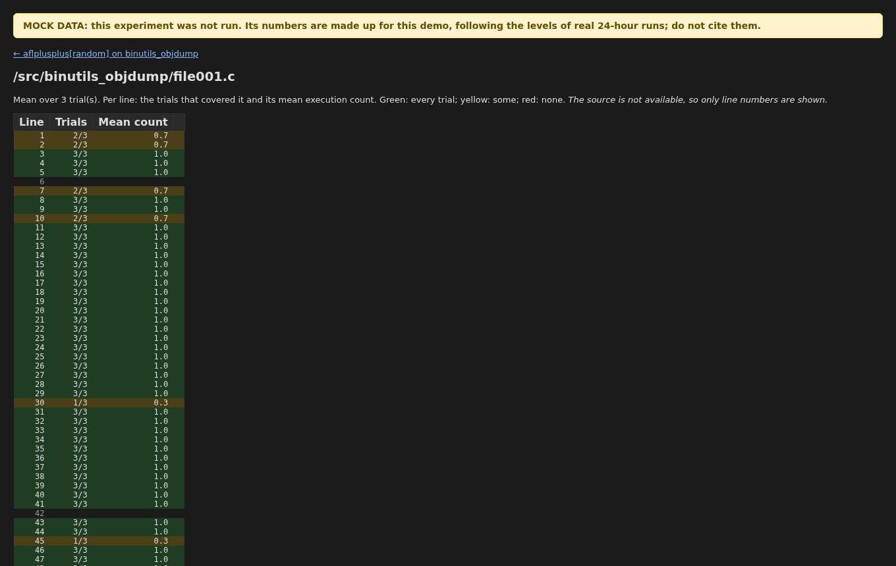

### Presence conditions

The SuperC report ([demo](https://configfuzzeval.vercel.app/experiments/2/superc)), once the experiment's SuperC
step or a SuperC post-analysis has run. SuperC gives every source line the `#if` condition under which it is
compiled. A condition is **in the build** when the coverage build instrumented at least one of its lines, and
**covered** when a trial executed one. See [SuperC presence-condition analysis](../README.md#superc-presence-condition-analysis).

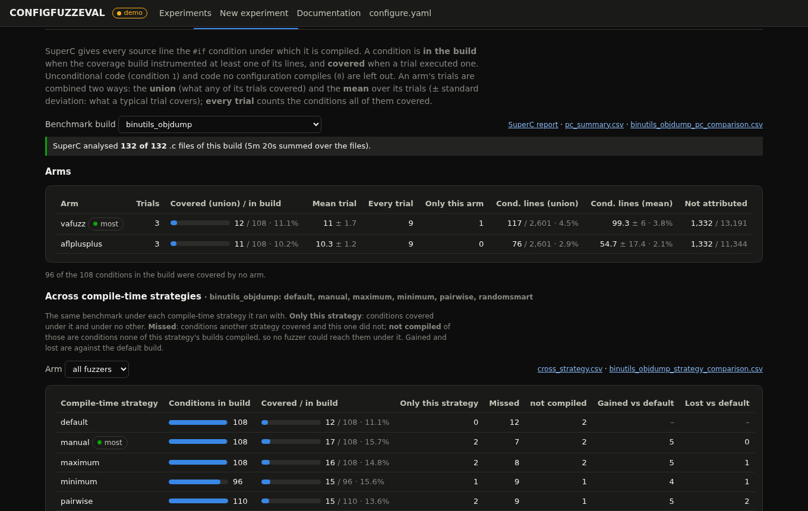

For each benchmark build (choose one in **Benchmark build** when there are several compile-time strategies):

- **SuperC's result per file:** how many `.c` files SuperC analysed, and which ones timed out or failed. Those
  files' lines have no condition and are left out of every count.
- **Arms:** each arm's trials combined both ways. **Covered (union)** is the conditions any trial covered,
  against the conditions in the build (with a bar). **Mean trial** is the average over the trials ± standard
  deviation, with the median in its tooltip. **Every trial** is the conditions all of the trials covered. The table
  also has the conditions only that arm covered, the conditional lines covered (union and mean), and the covered
  lines not attributed to any condition (in headers, or past the end of SuperC's tree). "most" marks the arm that
  covered the most conditions.
- **Conditions:** every condition with its instrumented lines and each arm's covered lines, shaded by the share
  covered. **Show** filters them: in the build, covered by some arm, covered by none, covered only by one arm, or
  covered by another arm but missed by one. **Trials** switches between the **union** (lines any trial covered)
  and the **mean** (the mean covered lines, and how many of the arm's trials covered the condition, such as
  `2/3`). **Sort** orders them by instrumented lines, lines no arm covered, lines one arm covered, or name, and the
  search box finds conditions such as `SUPPORT_JIT`. It loads 100 at a time; **Show more** loads the next 100.

  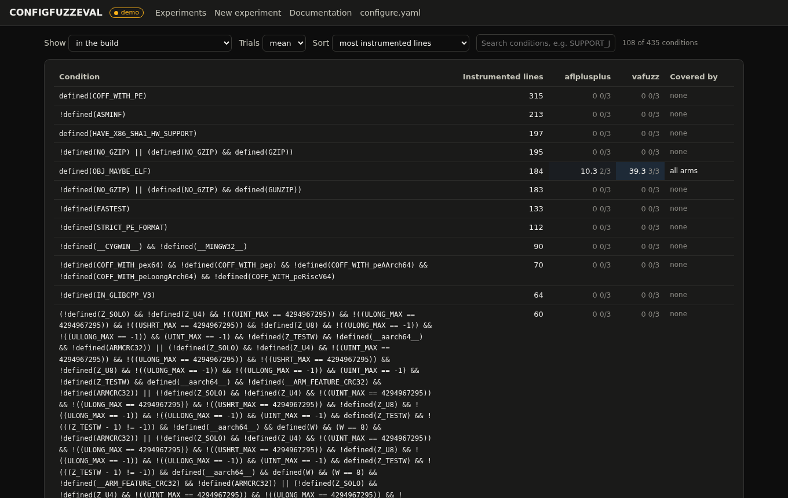
- **Across compile-time strategies:** shown when the benchmark ran under two or more strategies. For one arm, or
  all fuzzers together, each strategy's row has the conditions its builds compiled and its trials covered, the
  conditions **only this strategy** covered, the conditions it **missed** that another strategy covered (and of
  those, the ones its builds did **not** even **compile**), and what it **gained** and **lost** against the default
  build. Below it, every condition is listed with its covered lines under each strategy, or "not compiled",
  filtered by strategy: covered only under it, missed, not compiled, gained, lost, or covered under none.

  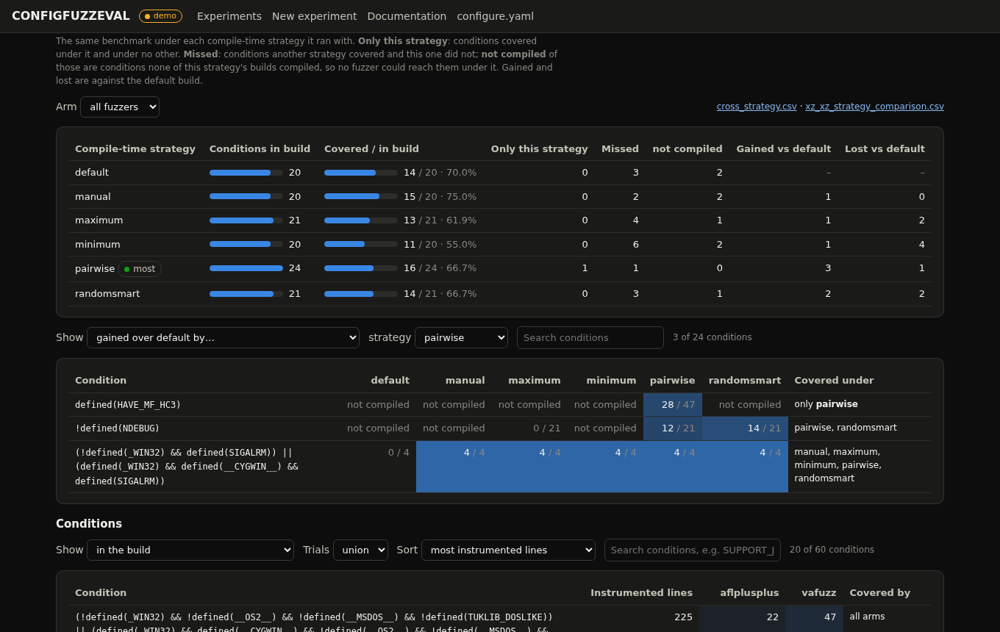
- **Links:** SuperC's own `index.html`, `pc_summary.csv`, the build's `<benchmark>_pc_comparison.csv`, and the
  cross-strategy CSVs.

### Coverage over time

Continuous campaigns only: per benchmark and metric, each arm's median trial after every coverage round, with its
worst-to-best range shaded.

### Post-analysis

Queues `post_analysis.py` on a finished experiment, as a job in the same queue
([demo](https://configfuzzeval.vercel.app/experiments/2/analyse)):

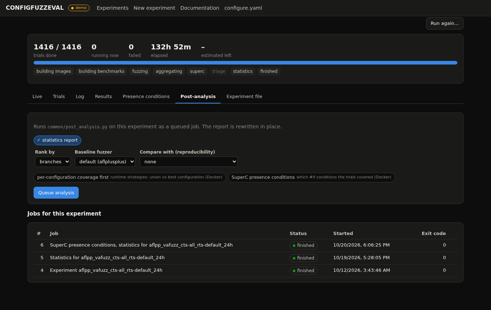

- **Statistics report:** the metric to rank by (branches, lines, regions or functions), the baseline fuzzer, and
  optionally another experiment to compare with, for the reproducibility section. The combined coverage reports are
  written with it.
- **Per-configuration coverage first:** runtime strategies only. Needed before the "union against best single
  configuration" table.
- **SuperC presence conditions:** runs the SuperC analysis, also on an experiment that ran without it.
- **Crash triage:** only when the experiment built a triage tool (see [Crash triage](../README.md#crash-triage)).

**Jobs for this experiment** lists the experiment's own job and every post-analysis, with its status, start time
and exit code. Their logs are in the Log tab's menu.

### Experiment file

The file the experiment ran with, with its record (when it was queued and started, its estimated end and the
command that stops it).

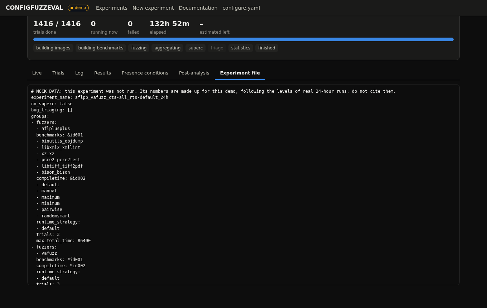

## Documentation page

**Documentation** ([demo](https://configfuzzeval.vercel.app/docs)) explains the plugin interfaces: how to add a
fuzzer, a benchmark, a compile-time or runtime configuration generator, a crash triage tool, or a post-analysis tool
like SuperC. It covers the files each needs, what the framework mounts and sets for it, and what it must produce,
and ends with the plugins currently in the repository.

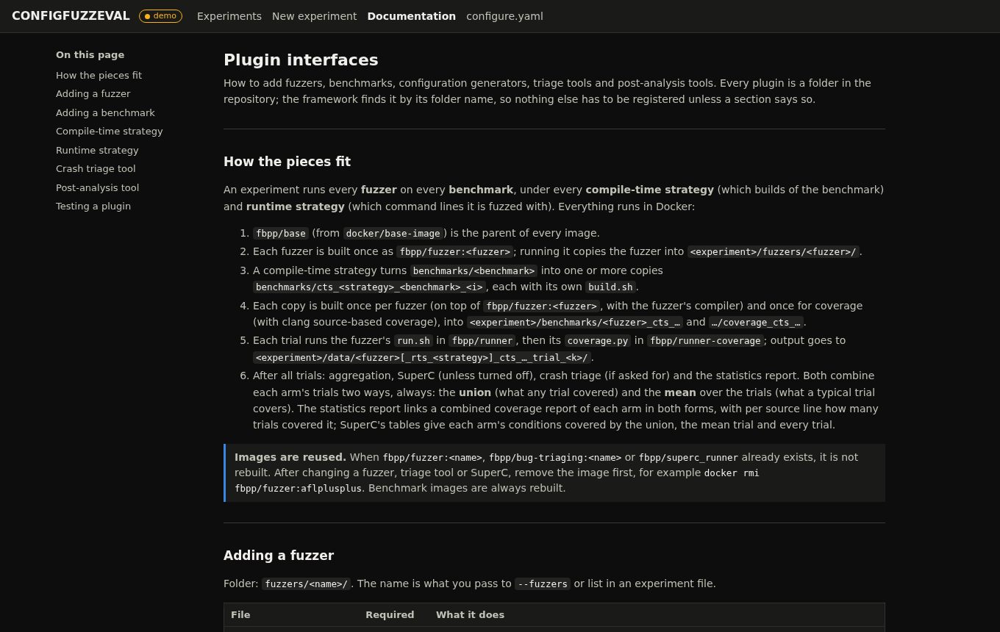

## Files

- `webapp/app.py`: the Flask app (pages and the JSON API the pages call); `webapp/experiments.py`,
  `webapp/superc_view.py` and `webapp/catalog.py` read the experiment folders, the SuperC report and the
  repository's fuzzers, benchmarks and strategies.
- `webapp/static/`, `webapp/templates/`: the pages. They are plain HTML, CSS and JavaScript, with no build step and
  no external scripts.
- `webapp/instance/`: the job queue shared with the command line (`jobs.db` and its lock files) and dry-run scratch
  files. It is not tracked by git. Deleting it empties the queue and the job history; experiments, experiment files
  and reports are kept.
- `webapp/screenshots/`: the images in this file, taken from the demo.
- `experiments/<name>.yaml`: every experiment's file with its record, and `experiments/logs/`: every log (see
  [How experiments run](../README.md#how-experiments-run)). The `experiments/` folder is not tracked by git.
- `<experiment>/events.jsonl`: written by `run_experiment.py`. It records the phases, each trial's start and end
  with its core and status, and the end of the experiment. Experiments from before this file existed still show,
  with their progress counted from the coverage reports.
- `run_experiment.py --dry-run --plan-json FILE`: writes the dry-run plan as JSON. The preview uses it.
